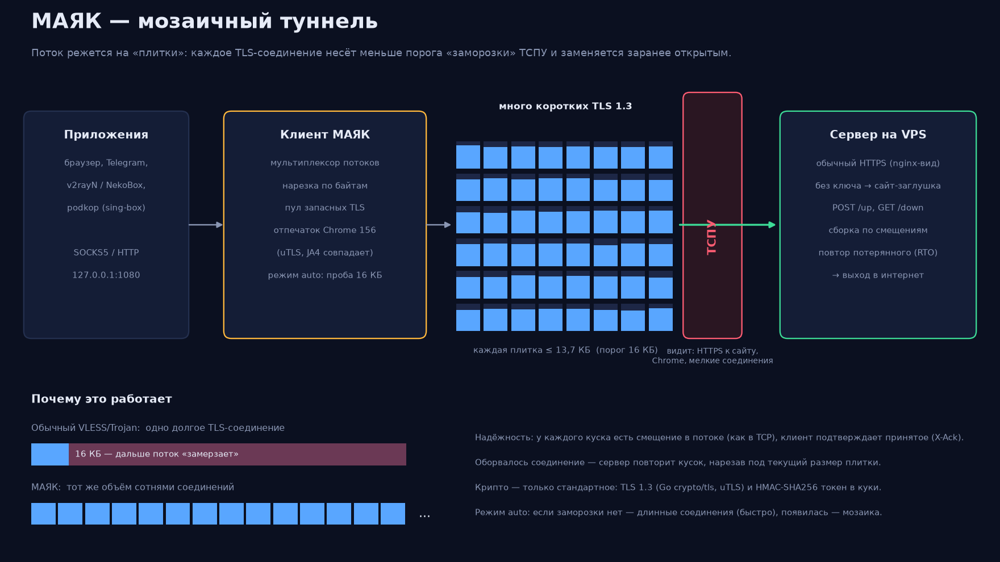
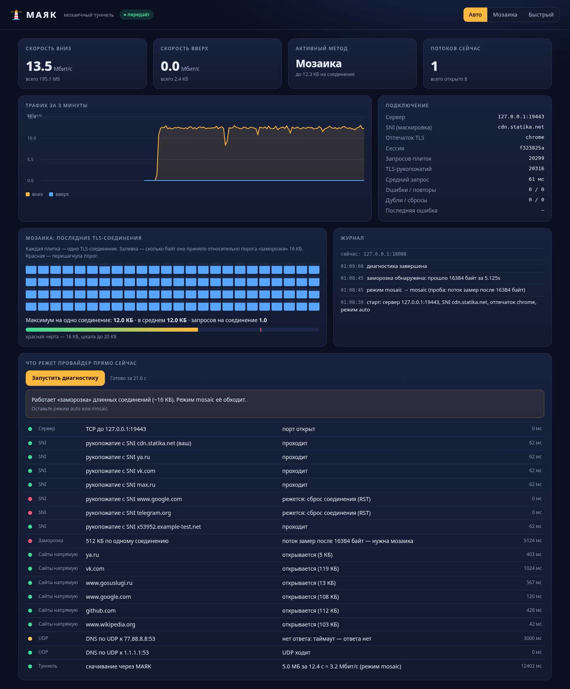
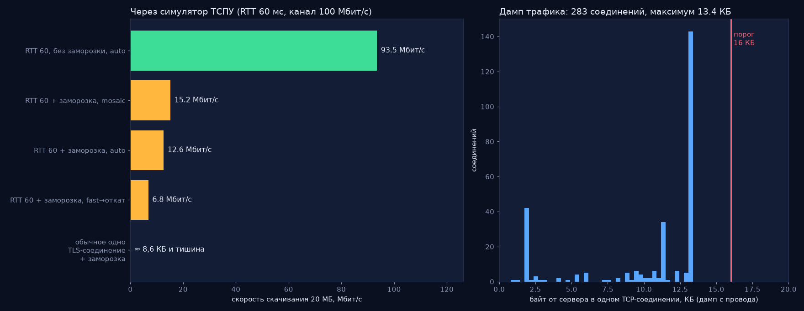

# 🗼 МАЯК — мозаичный туннель

Свой транспорт для обхода блокировок: TLS 1.3, отпечаток настоящего Chrome, HMAC.
Есть сервер для VPS, клиент для Windows, Linux, OpenWrt и Android, веб-панель
и встроенная диагностика «что режет провайдер прямо сейчас». Клиент умеет
ходить напрямую с обманом DPI (без сервера) и держать запасной вход из
публичных подписок Xray, если свой сервер недоступен.



## English

MAYAK (МАЯК, “lighthouse”) is an anti-censorship toolkit:

- a **mosaic TLS 1.3 tunnel** (client + server) that looks like ordinary Chrome HTTPS;
- **DPI desync** on the direct path (no server required);
- **Android VPN mode** via `VpnService` and [hev-socks5-tunnel](https://github.com/heiher/hev-socks5-tunnel);
- routing modes `tunnel` / `direct` / `auto`;
- **Xray reserve subscriptions** (VLESS, VMess, Trojan, Shadowsocks, Hysteria2) if your own server is down;
- **self-update** from the latest *stable* GitHub release (pre-releases, alpha/beta/rc are skipped):
  `SHA256SUMS` is verified with an embedded ed25519 key, then the file by SHA-256.
  Windows/Linux replace the binary and restart themselves, Android downloads the APK and
  opens the system installer, OpenWrt has `mayak-update` (+ daily cron, `uci set mayak.main.auto_update=0` to disable);
- **web panel** (0.3.4) at `/panel`: all subscription nodes with errors and latency, manual select/pin/speed test,
  subscription editor (secrets masked), refresh/recheck periods, log; password + session cookie + CSRF when not on localhost;
- **MikroTik RouterOS 7 containers** (0.3.3): ready `docker save` images for amd64/arm64/armv7
  (`mayak-container-{lite,full}-*.tar`), config via `MAYAK_<FLAG>` env vars, and a `-redirect`
  listener that takes router dst-nat'ed TCP 80/443 and recovers the target from TLS SNI / HTTP Host,
  so the router can send selected sites (DNS-driven address-list) or all web traffic through the tunnel.
  See [`mikrotik/README_RU.md`](mikrotik/README_RU.md).

Build the core with Go 1.27: `CGO_ENABLED=0 go build -trimpath -o mayak ./cmd/mayak`.
Deploy the server with `scripts/install-server.sh` or the systemd unit below
(`-public YOUR_SERVER_IP`). The installer prints a link of the form
`mayak://KEY@YOUR_SERVER:443?fp=chrome&mode=auto&sni=example.com#MAYAK`
and writes it to `/etc/mayak/link.txt`. Do not publish that link: it is the
access secret. See the Russian sections for build details, routing, DPI
techniques, Android/OpenWrt, and the disclaimer.

### Acknowledgements

The reserve entry works thanks to people who maintain free, constantly
refreshed subscription lists. Thank you!

- [@igareck](https://github.com/igareck) — [vpn-configs-for-russia](https://github.com/igareck/vpn-configs-for-russia): checked configs that work in Russia, including whitelist bypass.
- [@FLAT447](https://github.com/FLAT447) — [v2ray-lists](https://github.com/FLAT447/v2ray-lists): free VPN configs (whitelists).
- [@hamedcode](https://github.com/hamedcode) — [port-based-v2ray-configs](https://github.com/hamedcode/port-based-v2ray-configs): configs sorted by protocol and port, refreshed every 4 h.
- [@barry-far](https://github.com/barry-far) — [V2ray-Config](https://github.com/barry-far/V2ray-Config): a large worldwide list, refreshed every 15 minutes.
- [v2nodes.com](https://www.v2nodes.com/) — free nodes from many countries.

---

## Возможности

- **Мозаичный туннель.** С 2025 года ТСПУ «замораживает» TLS-соединения к
  многим зарубежным хостингам: первые ~16 КБ проходят, потом данные молча
  перестают идти. МАЯК режет поток на плитки: каждое TLS-соединение передаёт
  меньше порога (по умолчанию ≤ 14 000 байт вместе с рукопожатием) и уступает
  место новому, открытому заранее. Для DPI это похоже на браузер, который
  много раз ходит на обычный HTTPS-сайт.
- **Отпечаток Chrome 156.** ClientHello собран через uTLS и доработан до
  нынешнего Chrome (в том числе подписи ML-DSA и Trust Anchor IDs). JA4
  совпадает с настоящим Chrome 156.0.8078.47 (проверено по дампу).
- **Сайт-заглушка.** Без ключа сервер выглядит как «сайт раздачи статики» с
  заголовком `Server: nginx` — защита от активного зондирования.
- **Режим auto.** Клиент сам проверяет, есть ли заморозка. Если её нет —
  работает в **fast** (длинные соединения). Если есть — переходит в **mosaic**
  и подбирает размер плитки. Если поток замер во время работы, тоже переключается.
- **Прямой путь и обман DPI.** Режимы маршрута `tunnel` / `direct` / `auto`:
  сначала напрямую, при неудаче или заморозке — в туннель. Решение
  запоминается (30 мин «напрямую», 15 мин «туннель»).
- **VPN на Android.** `VpnService` + hev-socks5-tunnel, отдельное приложение
  вроде v2rayNG не нужно. Режим «только прокси :1080» тоже остался.
- **Запасной вход из подписок.** Если свой сервер МАЯК недоступен, трафик
  туннеля идёт через лучший живой узел из бесплатных подписок (ядро Xray).

Своей криптографии здесь нет. Шифрование — стандартный TLS 1.3
(Go `crypto/tls` на сервере, uTLS на клиенте). Авторизация — HMAC-SHA256
токен с меткой времени и защитой от повторов в куки `sid`.

## Сборка из исходников

Нужен [Go 1.27](https://go.dev/dl/).

```sh
git clone https://github.com/gamkam005/mayak.git
cd mayak
CGO_ENABLED=0 go build -trimpath -o mayak ./cmd/mayak
CGO_ENABLED=0 go build -trimpath -o tspusim ./cmd/tspusim   # симулятор ТСПУ, необязательно
./mayak version
go test ./...
```

Кросс-сборка:

```sh
# Linux
CGO_ENABLED=0 GOOS=linux  GOARCH=amd64 go build -trimpath -o build/mayak-linux-amd64  ./cmd/mayak
CGO_ENABLED=0 GOOS=linux  GOARCH=arm64 go build -trimpath -o build/mayak-linux-arm64  ./cmd/mayak

# Windows
CGO_ENABLED=0 GOOS=windows GOARCH=amd64 go build -trimpath -o build/mayak-windows-amd64.exe ./cmd/mayak

# Ядро для Android APK (исполняемый файл, кладётся как libmayak.so)
CGO_ENABLED=0 GOOS=android GOARCH=arm64 go build -trimpath -o build/mayak-android-arm64 ./cmd/mayak
```

### Android APK

Нужны JDK 17, Android SDK (platforms;android-34, build-tools;34.0.0) и NDK.
Сборка без Gradle.

```sh
# 1) нативная библиотека tun→SOCKS (клонирует hev-socks5-tunnel при необходимости)
NDK=/path/to/android-ndk scripts/build-hev.sh          # результат в ./hevbuild/libs

# 2) Go-ядро (см. выше) в ./build/mayak-android-arm64

# 3) подпись: скопируйте keystore.pass.example → android/keystore.pass
#    и поставьте свой пароль, либо export KS_PASS='…'
#    ключ создастся сам при первой сборке (android/mayak.keystore, в .gitignore)
export ANDROID_HOME=/path/to/sdk JAVA_HOME=/path/to/jdk17
export HEV=./hevbuild/libs BIN=./build
(cd android && ./build.sh)
# APK: android/out/MAYAK.apk
```

Для эмулятора x86_64: соберите ещё `mayak-linux-amd64` и hev с `x86_64`, затем
`X86=1 ./build.sh`.

### Облегчённая сборка (`-tags lite`) и пакеты OpenWrt

Тег `lite` выкидывает ядро Xray: бинарник ~8–10 МБ вместо ~32 МБ, всё
остальное (туннель, обман DPI, маршруты, панель) на месте, подписки
выключаются с сообщением в журнале.

```sh
L='-s -w -buildid='
CGO_ENABLED=0 GOOS=linux GOARCH=mipsle GOMIPS=softfloat go build -tags lite -trimpath -ldflags "$L" -o build/mayak-lite-linux-mipsle-softfloat ./cmd/mayak
CGO_ENABLED=0 GOOS=linux GOARCH=mips   GOMIPS=softfloat go build -tags lite -trimpath -ldflags "$L" -o build/mayak-lite-linux-mips-softfloat   ./cmd/mayak
CGO_ENABLED=0 GOOS=linux GOARCH=arm    GOARM=7          go build -tags lite -trimpath -ldflags "$L" -o build/mayak-lite-linux-armv7            ./cmd/mayak
CGO_ENABLED=0 GOOS=linux GOARCH=arm64                   go build -tags lite -trimpath -ldflags "$L" -o build/mayak-lite-linux-arm64            ./cmd/mayak
CGO_ENABLED=0 GOOS=linux GOARCH=amd64                   go build -tags lite -trimpath -ldflags "$L" -o build/mayak-lite-linux-amd64            ./cmd/mayak
# + полные mayak-linux-amd64 / mayak-linux-arm64 (с Xray) для пакетов mayak-full
VER=0.3.4 BIN=./build OUT=./build openwrt/build-ipk.sh
```

Получаются `mayak_<ver>_<arch>.ipk` (lite) для x86_64, aarch64_generic,
aarch64_cortex-a53, arm_cortex-a7_neon-vfpv4, mipsel_24kc, mips_24kc и
`mayak-full_<ver>_<arch>.ipk` (с Xray) для x86_64 и aarch64. Пакеты
взаимоисключающие.

## Автообновление

Клиент сам ставит новые версии — без перехода по ссылкам. Источник —
последний релиз GitHub с пометкой **Latest**; предварительные версии
(pre-release, alpha, beta, rc, dev…) и всё, что не новее установленного,
пропускаются. Перед установкой `SHA256SUMS` релиза проверяется подписью
ed25519 (`SHA256SUMS.sig`, открытый ключ встроен в программу), затем файл —
по SHA-256. Если GitHub напрямую недоступен, загрузка идёт через сам МАЯК.

- **Windows / Linux** (`mayak client`, двойной щелчок): проверка через 30 с
  после запуска и раз в 6 ч. Новая версия ставится на место старой
  (старая — `.old`, удаляется при следующем запуске), клиент перезапускается
  с теми же параметрами. `link.txt` и `subs.json` не трогаются. Выключить:
  `-noupdate` или пустой файл `noupdate` рядом с программой. Вручную:
  `mayak update` (`-check` — только проверить).
- **Android**: проверка при открытии (не чаще раза в 6 ч) и кнопка
  «Проверить обновления». «Обновить» скачивает APK и открывает системный
  установщик — Android всегда просит подтвердить установку.
- **OpenWrt**: `mayak-update` (opkg на 24.x; на 25.x/без пакета заменяется
  `/usr/bin/mayak`), `mayak-update -n` — только проверить. Раз в сутки по
  cron; выключить: `uci set mayak.main.auto_update=0; uci commit mayak;
  /etc/init.d/mayak restart`.

Выпуск релиза (для автора): `sha256sum * > SHA256SUMS` и
`mayak sign -key <закрытый ключ> SHA256SUMS` → `SHA256SUMS.sig`; закрытый ключ
в репозиторий не кладётся. Релиз без верной подписи клиенты не ставят.

## Сервер на VPS

Нужен зарубежный VPS с Linux и systemd. Списки «живых» и «замороженных»
хостингов меняются; на «замороженном» МАЯК всё равно работает за счёт мозаики,
но медленнее. Если заморозки нет, режим auto сам включит fast.

Самый простой путь — скрипт:

```sh
# бинарник mayak-linux-amd64 (или arm64) лежит рядом со скриптом
scp mayak-linux-amd64 scripts/install-server.sh scripts/uninstall-server.sh root@YOUR_SERVER_IP:/root/mayak/
ssh root@YOUR_SERVER_IP "bash /root/mayak/install-server.sh"
```

Необязательные переменные: `PORT=8443`, `SNI=example.com`, `CN=cdn.example.net`,
`CERT=/путь KEY=/путь` (свой сертификат, например Let's Encrypt),
`PUBLIC=YOUR_SERVER_IP`.

Скрипт создаст пользователя `mayak`, каталог `/etc/mayak` (права 700, ключи 600),
службу systemd на порту 443, секрет и самоподписанный сертификат. В конце
напечатает ссылку и запишет её в `/etc/mayak/link.txt`.

### Пример unit-файла

```ini
[Unit]
Description=MAYAK tunnel server
After=network-online.target
Wants=network-online.target

[Service]
User=mayak
ExecStart=/usr/local/bin/mayak server -listen :443 -state /etc/mayak -public YOUR_SERVER_IP -cn cdn.example.net
Restart=always
RestartSec=3
AmbientCapabilities=CAP_NET_BIND_SERVICE
CapabilityBoundingSet=CAP_NET_BIND_SERVICE
NoNewPrivileges=true
ProtectSystem=strict
ProtectHome=true
ReadWritePaths=/etc/mayak
PrivateTmp=true
LimitNOFILE=65535

[Install]
WantedBy=multi-user.target
```

Проверка: `https://YOUR_SERVER_IP/` в браузере должен открыть сайт-заглушку
(предупреждение о сертификате для самоподписанного — это нормально).
Удаление: `scripts/uninstall-server.sh` (секреты в `/etc/mayak` он не трогает).

### Как выглядит ссылка

```
mayak://KEY@YOUR_SERVER:443?fp=chrome&mode=auto&sni=example.com&pin=sha256-…#MAYAK
```

Её печатает `mayak server` (и `install-server.sh`). Это и есть ключ доступа:
не публикуйте ссылку в git, в Issues и в чатах. Параметры:

- `sni` — имя, которое клиент подставляет в ClientHello (по умолчанию `-cn`);
- `pin` — SHA-256 отпечаток сертификата сервера;
- `fp=chrome`, `mode=auto`, `budget=14000`.

Свой домен и Let's Encrypt (`CERT=… KEY=…`) позволяют убрать `pin` и не пугать
зондирование «странным» сертификатом. Самоподписанному сертификату лучше
давать безликое `-cn` вроде `cdn.example.net`, а не настоящее имя вашего сайта.

## Клиенты

### Windows и Linux

Для Windows есть готовый архив `MAYAK-windows-<ver>.zip` в Releases
(`mayak.exe`, `link.txt`, `subs.json`, bat-файлы, `ПРОЧТИ.txt`).

1. Положите ссылку одной строкой в `link.txt` (рядом с `mayak.exe`)
   или передайте `-link 'mayak://KEY@YOUR_SERVER:443?…'`. Без ссылки тоже
   работает: напрямую с обманом DPI и через бесплатные подписки.
2. Запуск: двойной щелчок по `mayak.exe` — режим «просто работай»
   (`-route auto -subs reserve`, на Windows ещё и системный прокси, который
   возвращается как был при закрытии окна). То же из командной строки:
   `mayak client -easy`. Панель — `http://127.0.0.1:9090/`, прокси SOCKS5 и
   HTTP — `127.0.0.1:1080`.
3. Windows: `autostart-on.bat` / `autostart-off.bat` — автозапуск при входе
   (свёрнутым окном), `stop.bat` — остановить и выключить системный прокси.
4. Как направить трафик:
   - браузеры на Windows: системный прокси (сам при двойном щелчке, флаг
     `-sysproxy`, или вручную `proxy-on.bat` / `proxy-off.bat`);
   - любой клиент с SOCKS: `socks5://127.0.0.1:1080`;
   - Telegram: Настройки → Продвинутые → Тип соединения → SOCKS5 `127.0.0.1:1080`.

Полезные флаги: `mayak client -h`. Например `-listen 0.0.0.0:1080` — отдать
прокси другим устройствам в сети; `-route auto|direct|tunnel`; `-subs reserve`.

Без своей ссылки клиент тоже работает: `-route direct` (только обман DPI) или
`-subs always` / `-subs reserve` с подписками.

### Android

1. Установите `MAYAK.apk` (arm64, без Google-сервисов; разрешите установку
   из этого источника).
2. Вставьте ссылку `mayak://…` (нужна для своего туннеля), сохраните, нажмите
   «Запустить». Можно включить режим «VPN — весь телефон» или оставить
   «только прокси :1080».
3. На аппаратах Huawei/Honor отключите автоматическое управление запуском
   (Настройки → Батарея → Запуск приложений → МАЯК → вручную), иначе система
   усыпит службу.
4. Секреты в журнале приложения маскируются; журнал можно поделиться,
   скопировать или очистить.

### OpenWrt и podkop

Пакет `.ipk` или скрипт `openwrt/install-openwrt.sh` (рядом положите
бинарник `mayak-lite-linux-<arch>` из Releases). Панель по умолчанию на
**9091**, чтобы не спорить с Clash API на 9090, если рядом стоит podkop.
Панель слушает все адреса, поэтому с 0.3.4 она под паролем: пароль лежит в
`/etc/mayak-ui.pass` (`cat /etc/mayak-ui.pass`).

Какой пакет: архитектура — `opkg print-architecture` (или `grep ARCH
/etc/openwrt_release`). Обычный `mayak` — lite (~3–4 МБ в архиве, ~8–10 МБ на
диске) без подписок. `mayak-full` (~30 МБ на диске, только x86_64/aarch64) —
с запасным входом из подписок: `uci set mayak.main.subs=reserve`. В OpenWrt
25.x вместо opkg пакетный менеджер apk: `.ipk` туда не ставится, используйте
`install-openwrt.sh` с бинарником.

```sh
scp -O mayak_0.3.4_x86_64.ipk root@192.168.1.1:/tmp/
ssh root@192.168.1.1
opkg install /tmp/mayak_0.3.4_x86_64.ipk
uci set mayak.main.link='mayak://KEY@YOUR_SERVER:443?…'
uci set mayak.main.enabled=1
uci commit mayak
/etc/init.d/mayak start
logread -e mayak
```

Опции UCI (`/etc/config/mayak`): `link`, `listen`, `ui`, `mode`, `budget`,
`route` (tunnel/direct/auto), `desync`, `doh`, `subs` (off/reserve/always,
только mayak-full), `sub_state` (кэш, по умолчанию `/tmp/mayak-subs`), `debug`,
`auto_update` (1 — раз в сутки `mayak-update`).
Без ссылки служба запускается, если `route=direct` или `subs≠off`.

Для podkop МАЯК — обычный SOCKS5 `socks5://127.0.0.1:1080`. Можно добавить его
как ещё один узел urltest или отдельной секцией. Если у вас есть свой скрипт,
который периодически перезаписывает `urltest_proxy_links`, пропишите МАЯК в
этот скрипт как постоянный узел — иначе ссылка пропадёт.

Адрес вашего VPS не должен попадать в списки, которые podkop отправляет в
прокси. UDP через МАЯК не ходит, поэтому для этих доменов QUIC уйдёт в TCP.

Перед правкой конфига podkop сделайте копию:
`cp /etc/config/podkop /etc/config/podkop.bak-$(date +%F)`.
После `podkop restart` трафик прервётся примерно на 5–15 секунд.

### MikroTik (RouterOS 7, контейнер)

С 0.3.3 МАЯК запускается прямо на MikroTik, в контейнере RouterOS, без OpenWrt.
В релизе есть готовые образы `mayak-container-{lite,full}-{amd64,arm64,armv7}.tar`
(формат `docker save`, подходят и для docker/podman). Сборка из исходников:
`mikrotik/build-images.sh`. Для RB4011 нужен `armv7`.

Роутер отправляет в контейнер (dst-nat) TCP 80/443 к выбранным сайтам или весь
веб-трафик LAN. Новый приёмник `-redirect` (в образе — порт 8443) берёт имя сайта
из SNI/Host и ведёт соединение через туннель. Список сайтов наполняет сам DNS
роутера (`/ip dns static … type=FWD match-subdomain=yes address-list=via-mayak`).

Пошаговая инструкция для RB4011 (device-mode, файлы, два режима, откат) и
готовые скрипты `mayak-install.rsc`, `mayak-route-list.rsc`,
`mayak-route-all.rsc`, `mayak-remove.rsc` лежат в [`mikrotik/`](mikrotik/README_RU.md).
Всё проверено на RouterOS 7.25.1 (CHR).

Любой флаг `mayak client` можно задать переменной окружения `MAYAK_<ФЛАГ>`
(`-sub-state` → `MAYAK_SUB_STATE`); флаги командной строки важнее.

## Благодарности

Запасной вход работает благодаря людям, которые бесплатно ведут и
постоянно обновляют подписки. Спасибо вам!

- [@igareck](https://github.com/igareck) — [vpn-configs-for-russia](https://github.com/igareck/vpn-configs-for-russia): проверенные конфиги, работающие в РФ, в том числе обход белых списков.
- [@FLAT447](https://github.com/FLAT447) — [v2ray-lists](https://github.com/FLAT447/v2ray-lists): бесплатные VPN-конфиги (белые списки).
- [@hamedcode](https://github.com/hamedcode) — [port-based-v2ray-configs](https://github.com/hamedcode/port-based-v2ray-configs): конфиги по протоколам и портам, обновление каждые 4 ч.
- [@barry-far](https://github.com/barry-far) — [V2ray-Config](https://github.com/barry-far/V2ray-Config): большой мировой список, обновление каждые 15 минут.
- [v2nodes.com](https://www.v2nodes.com/) — бесплатные узлы из разных стран.

## Панель и диагностика



Плитки — последние TLS-соединения: заливка показывает, сколько байт прошло
по каждому относительно порога 16 КБ. Скриншот снят на тестовом стенде с
симулятором ТСПУ (заморозка 16 КБ, RTT 60 мс, сброс SNI `www.google.com` и
`telegram.org`).

Диагностика в панели проверяет: доступен ли IP сервера, какие SNI режутся,
есть ли заморозка и на каком объёме, открываются ли российские и зарубежные
сайты напрямую, ходит ли UDP. В конце замеряет скорость через туннель.

## Маршрут и приёмы DPI

| флаг | что делает |
|---|---|
| `-route tunnel` | всё через сервер |
| `-route direct` | всё напрямую с обманом DPI; ссылка/сервер не нужны |
| `-route auto` | сначала напрямую; нет ServerHello, IP не отвечает, заморозка или сайт из списка «в туннель» — через сервер. Решение помнится 30 мин / 15 мин |
| `-desync tlsrec+split,tlsrec+disorder,…` | приёмы по очереди: не прошёл один — пробуется следующий |
| `-direct-timeout 4s`, `-freeze 8s` | ожидание ответа напрямую; порог заморозки (`0` = выкл) |
| `-tunnel-hosts`, `-direct-hosts` | свои списки: `a.com,1.2.3.0/24` или `@файл` |
| `-doh 1.1.1.1,8.8.8.8,9.9.9.9` | DNS прямого пути через DoH по IP (`off` = системный) |

Приёмы (`-desync`, через запятую, параметры через `/`):

- `tlsrec[:at=mid|sni|sniext]` — ClientHello режется на две TLS-записи;
- `multirec` — четыре записи (начало/середина/конец имени);
- `split[:at=sni|mid|end|sniext|N]` — граница TCP-сегмента;
- `disorder` — первый сегмент уходит с TTL=1 и теряется, ядро перешлёт позже;
- `fake[:ttl=N/md5]` — перед настоящим сегментом уходит фейк с чужим SNI;
  `md5` — подпись TCP MD5, сервер отбрасывает фейк даже при большом TTL
  (root не нужен, нужен `CONFIG_TCP_MD5SIG`);
- `oob` — один байт «срочных» данных;
- `hmod` — переписывание HTTP Host;
- `none`.

Пример: `tlsrec+fake:ttl=6/md5`. Всё без root на Linux/Android; на Windows
доступны `tlsrec` и `split` (остальное сводится к split). Без root нельзя
подделать seq/ack и TCP-флаги — для этого нужны сырые сокеты.

`.ru`, Яндекс и VK по умолчанию идут напрямую без трюков. Встроенный список
«в туннель» включает популярные заблокированные по IP сервисы.

## Запасной вход из подписок (0.3.0)

Режимы (`-subs`, в приложении — переключатель на главном экране):

- `off` — только свой сервер и/или прямой путь;
- `reserve` (по умолчанию) — пока МАЯК отвечает, трафик через него; два
  провала проверки подряд (~20–60 с) — переход на подписки, при
  восстановлении — обратно;
- `always` — только подписки.

Форматы: обычный список ссылок, base64, Clash/Mihomo YAML. Протоколы — см.
выше. Свои подписки: `-sub https://…` или `-sub-file subs.json`.

Проверка экономная: за прогон не больше 150 кандидатов (`-sub-max`), поровну
из каждой подписки; TCP-пинг 32 параллельно, затем настоящий запрос через
Xray у 48 лучших. Второй тест — открывает ли выход заблокированные сайты
(часть «живых» серверов в «белых» подсетях этого не делает). В пуле
остаются лучшие; повторная проверка каждые 30 минут, полный прогон каждые 6 часов.

Встроенные пресеты — публичные бесплатные подписки (в том числе «белые»
списки и [v2nodes](https://www.v2nodes.com/)). Их держат чужие люди и видят,
куда вы ходите: не для банков и рабочих аккаунтов.

С 0.3.4 периоды настраиваются: `-sub-refresh 6h`, `-sub-recheck 30m`,
`-sub-test-url URL` (env `MAYAK_SUB_REFRESH`, `MAYAK_SUB_RECHECK`, `MAYAK_SUB_TEST_URL`)
или поля `refresh`, `recheck`, `test_url` в `subs.json`. Применяются без перезапуска.
Если подписка просит обновляться чаще (заголовок `profile-update-interval`, в часах),
МАЯК так и делает, но не чаще раза в 15 минут. Отключается
`"honor_update_interval": false` или `-sub-honor=false`.

Сбой активного сервера: МАЯК сразу, вне очереди, проверяет его ещё 2 раза настоящим
запросом. Если ни одна проверка не прошла, сервер выбывает и трафик уходит на
следующий живой. Выбранный вручную сервер, когда он выбывает, сменяется
автовыбором (это видно в журнале и панели). Если обновление подписки поменяло
настройки активного сервера или убрало его, МАЯК сразу переходит на новые
настройки или на следующий живой.

### Веб-панель серверов (0.3.4)

`http://<адрес панели>/panel` — вкладки «Узлы», «Подписки», «Настройки» и «Лог».
На localhost пароль не нужен. На любом другом адресе нужен пароль:
`-ui-pass` / `MAYAK_UI_PASS`, `-ui-pass-file`, или `/etc/mayak/ui.pass`. Если ничего
не задано, МАЯК создаёт случайный пароль в `/data/ui.pass` (OpenWrt:
`/etc/mayak-ui.pass`, иначе рядом с программой) и пишет в журнал только путь.
Сессия хранится в cookie (HttpOnly, SameSite=Strict), все POST защищены от CSRF,
после 5 неверных паролей вход временно блокируется. `-ui-tls` включает HTTPS с
самоподписанным сертификатом.

Необязательно, на сервере: `mayak picker` качает подписки, отбрасывает
мёртвые и отдаёт готовую ленту `http://YOUR_SERVER/<секрет>/sub`.

### Тест загрузки и AS узлов (0.3.5)

Короткая проверка (`generate_204`) показывает, что узел **отвечает**. Но ТСПУ
замораживает соединения с сетями многих хостингов после ~16 КБ, и такой узел
на настоящей загрузке встаёт. Поэтому после неё МАЯК качает через узел 256 КБ
одним соединением и ставит статус: «качает», «медленно», «заморожен» или
«отвечает» (загрузку проверить не вышло). Замороженные — последние в
автовыборе. В панели у каждого узла видны IP, AS (встроенная база IPtoASN) и
❄, если сеть в списке замороженных по замерам
[freeze-check](https://github.com/MarkSinD/freeze-check); ниже — история тестов.
Свой сервер МАЯК проверяется отдельно (карточка «Свой сервер МАЯК»).
`-sub-freeze-url -` выключает тест загрузки. Размер плитки mosaic:
`MAYAK_BUDGET` / `-budget` или поле «Плитка mosaic» в настройках панели.

## Что протестировано

Стенд: одна Linux-машина, сервер + `tspusim` + клиент, файл 20 МБ, целостность
по SHA-256. Полный вывод — `tests/e2e-results.txt`, повтор: `tests/e2e.sh ./mayak ./tspusim`.

| Сценарий | Скорость | Итог |
|---|---|---|
| Одно обычное TLS-соединение через «ТСПУ» с заморозкой | — | 8,6 КБ, дальше тишина |
| МАЯК mosaic, RTT 60 мс + заморозка 16 КБ | **15,2 Мбит/с** | целостность OK, 1787 соединений, максимум 13 725 байт на соединение |
| МАЯК auto, RTT 60 мс + заморозка | **12,6 Мбит/с** | сам нашёл порог, плитка ~12,3 КБ |
| МАЯК fast принудительно + заморозка | 6,8 Мбит/с | поток замер → переход в mosaic, данные целы |
| МАЯК auto, RTT 60 мс без заморозки | **93,5 Мбит/с** | выбрал fast (канал стенда 100 Мбит/с) |
| loopback, mosaic / fast | 243 / 2803 Мбит/с | без сети, предел самой программы |

Ещё: дамп с провода (ни одного соединения выше 16 384 байт, `docs/results.png`);
JA4 = Chrome 156; пакет OpenWrt ставится настоящим `opkg` 24.10 в chroot;
установщик сервера прогнан на заглушке systemctl. Приёмы DPI и VPN-цепочка —
в `tests/desync-netns.sh` и `tests/vpn-netns.sh` (нужен sudo), результаты в
`tests/*-results.txt`.



Юнит-тесты: `go test ./...`. Живая проверка пресетов подписок (нужна сеть):
`MAYAK_LIVE=1 go test ./internal/sub -run TestLive -v`.

## Что не претендует на проверку в бою

- Поведение настоящего ТСПУ может отличаться от модели (например, если начнут
  считать частоту новых соединений к одному IP). Первым делом запускайте
  «Диагностику» в панели.
- systemd/procd и бинарники ARM/MIPS на «живом» железе зависят от вашей среды.
- Скорость mosaic растёт с числом параллельных плиток (`-down-workers`, по
  умолчанию 16) и падает с RTT до VPS.

## Ограничения и отказ от ответственности

- **Белые списки и блокировку по IP МАЯК не обходит.** Если оператор пропускает
  только разрешённые подсети, а ваш VPS не в них, нужен другой адрес. Подмена
  SNI на популярный российский домен не спасает: ТСПУ сверяет SNI с IP.
- **Много коротких соединений — сама по себе примета.** Это компромисс ради
  обхода заморозки. В режиме fast такой приметы нет.
- **Нет UDP** в туннеле и в VPN-режиме. Звонки в мессенджерах, игры и QUIC
  через МАЯК не пойдут (браузеры перейдут на TCP сами).
- Скорость mosaic ограничена задержкой до VPS: порядка 1 МБ/с на 16 плиток
  при RTT 60 мс. Для видео в HD обычно хватает, для торрентов — нет.
- Бесплатные серверы из подписок — чужие машины. Не используйте их для
  чувствительных аккаунтов.
- Серверы с `allowInsecure` по TCP-TLS проходят через закрепление сертификата
  при первом подключении (в актуальном Xray allowInsecure убран). Hysteria2
  с самоподписанным сертификатом без `pinSHA256` проверку не пройдёт.

Это молодой проект, а не проверенный годами продукт. Для важного держите
рядом запасной способ доступа. Пользуйтесь в соответствии с законами вашей
страны; авторы не несут ответственности за применение программы.

## Как это устроено (для любопытных)

- Клиент → сервер: `POST /api/v1/up`, заголовок `X-Off` — смещение куска в
  потоке вверх. Сервер собирает поток (`protocol.Reasm`) и применяет кадры
  по порядку.
- Сервер → клиент: `GET /api/v1/down` (long-poll до 8 с). `X-Ack` — сколько
  клиент уже получил, `X-Max` — максимальный кусок. Неподтверждённое
  повторяется через RTO.
- Внутри потока кадры `[stream u32][type u8][len u16][payload]`: SYN (адрес
  цели), DATA, FIN, RST. Через одну сессию идёт много TCP-потоков. DNS целей
  разрешается на сервере.
- Авторизация: куки `sid` = base64(ts \| nonce \| session \| HMAC-SHA256(ключ, …)[:16]).
  Окно ±120 с, повтор nonce отклоняется. Ключ = SHA-256 от секрета из ссылки.

## Лицензия

Собственный код — [MIT](LICENSE). Ядро Xray подключается как библиотека
(MPL-2.0), hev-socks5-tunnel — MIT, идеи обхода DPI — из byedpi (MIT), код
свой. Из ByeByeDPI (GPL-3.0) ничего не копировалось. Подробности и ссылки —
в [LICENSES.md](LICENSES.md).

История версий: [CHANGELOG.md](CHANGELOG.md).
